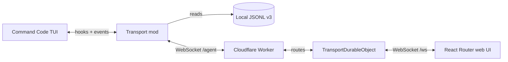

<div align="center">
  <h1>Transport</h1>
  <p><b>Your Command Code session, in the browser.</b></p>
  <p>A live web remote for Command Code — history, streaming, prompts, approvals, and questions.</p>
</div>

<div align="center">
  
  &nbsp;
  
  &nbsp;
  
  &nbsp;
  
  &nbsp;
  
  &nbsp;
  
</div>

<br>

Transport is a Command Code mod and a Cloudflare relay that mirror a running `cmd` session to a web UI. The terminal stays the source of truth: the mod taps the session event stream, reads local JSONL v3 history, and forwards ACP-style `sessionUpdate` events through a Durable Object to the browser. The browser renders the conversation and sends prompts, permission decisions, and questionnaire answers back into the running TUI.

## Contents

- [Features](#-features)
- [Architecture](#-architecture)
- [Quick start](#-quick-start)
- [Using the mod](#-using-the-mod)
- [Web UI](#-web-ui)
- [Development](#-development)
- [Testing](#-testing)
- [Deployment](#-deployment)
- [Security](#-security)
- [Limitations](#-limitations)
- [Troubleshooting](#-troubleshooting)
- [Roadmap](#-roadmap)
- [Acknowledgements](#-acknowledgements)

## ✨ Features

- **Live session mirror** — assistant messages, reasoning, tool calls, diffs, plans, and run state stream to the browser as they happen.
- **Local history, no upload** — the mod parses Command Code's local JSONL v3 transcripts and serves paginated history on request. Transcripts never leave the machine.
- **Prompt from the web** — send a new prompt when the agent is idle; the composer is disabled while a run is active.
- **Approve from the web** — plan mode (enter and exit) and safety-prompt Allow decisions can be answered from the browser while the TUI stays attached.
- **Answer agent questions** — `ask_user_question` supports single-select, multi-select, and free-text answers from the web.
- **Session switching** — the sidebar lists every connected session; switching loads that session's history and live stream.
- **Hot-reload friendly** — the transport target and `agentId` live in `cmd.state`, so a mod reload reconnects with the same identity instead of creating a duplicate session.
- **Zero relay storage** — the Durable Object routes messages in memory and writes nothing. When the socket drops, sessions disappear until the agent reconnects.
- **Polished UI** — shadcn/ui dashboard, light/dark themes, streaming Markdown, syntax-highlighted code, and a floating prompt overlay that keeps the conversation visible.

## 🏗 Architecture



The system has three layers:

| Layer | Path | Responsibility |
|---|---|---|
| **Mod** | `mod/src/` | Hooks into `cmd`, streams events, reads JSONL v3 history, injects approvals into the TUI |
| **Relay** | `workers/` | Serves the web app, routes `/agent` and `/ws`, tracks presence and pending interactions |
| **Web UI** | `app/` | Session list, chat feed, prompt cards, composer, theme |

The Worker uses a single Durable Object instance (`idFromName("global")`). The DO keeps agents and browsers in memory, deduplicates sessions by `sessionId`, and closes older registrations when a new `hello` arrives for the same session.

### Message flow

1. The mod connects to `/agent` and sends `hello` with `agentId`, `sessionId`, name, cwd, and model.
2. A browser connects to `/ws`, receives the session list, and selects a session.
3. The browser requests history; the mod parses the local JSONL v3 transcript and replies with paginated entries.
4. Live events are forwarded as `sessionUpdate` messages and merged into the feed.
5. Prompts travel browser → relay → mod → TUI. Permission and question prompts travel the other way, and their answers follow the same path back to the host.

## 🚀 Quick start

### Requirements

- **Node.js 22+** and npm
- **Command Code** with mod support
- A modern browser
- A Cloudflare account only if you want to deploy

### Run locally

From the repository root:

```bash
npm install
npm run dev
```

Vite prints the dev URL. It is usually `http://localhost:5173`, but it can pick another port if that one is occupied — use the URL it prints.

Install the mod into the current user's Command Code profile:

```bash
npm run mod:update
```

This builds the single-file bundle (`dist/transport.ts`) and copies it to `~/.commandcode/mods/transport.ts`.

Start Command Code and point the mod at the dev relay:

```text
/transport localhost:5173
```

Open the web URL, select the session, and chat. Use the exact port Vite printed; if the web UI is on `5174`, run `/transport localhost:5174`.

### Connect to a deployed relay

```text
/transport your-worker.your-subdomain.workers.dev
```

Hosts without a scheme default to `wss://`. `localhost` and `127.0.0.1` always use `ws://` so local development works without TLS.

## 🧩 Using the mod

Start a session and connect it:

```text
/transport <host>[:port]
```

Examples:

```text
/transport localhost:5173
/transport your-worker.your-subdomain.workers.dev
```

Notes:

- `/transport` only accepts a host. There is no `/transport off`; close the `cmd` process (or `/exit`) to disconnect.
- The target and `agentId` are persisted in `cmd.state`. On hot reload, the new mod instance reconnects to the same relay session.
- If a session was created by a build that predates state persistence, run `/transport <host>` once; later reloads reconnect automatically.
- To try the bundle without installing it: `cmd --mod ./dist/transport.ts`.
- Connection diagnostics are appended to `~/.commandcode/transport-debug.log`.

### Approvals from the web

Transport injects keys into the Ink TUI rather than replacing the TUI's prompt. The terminal can still answer; the first answer wins.

| Interaction | Approve / Allow | Cancel / Deny |
|---|---|---|
| Exit plan mode | `Ctrl+A` — exit plan mode and auto-accept edits | `Esc` — stay in plan mode |
| Enter plan mode | `1` | `2` |
| Safety permission prompt | `1` — forwarded to the terminal prompt | Denied directly from the permission hook |
| Regular permission prompt | Returned from the hook | Returned from the hook |

Approvals are retried briefly because the TUI prompt may not be mounted at the exact moment the browser answers. If the terminal responds first, the pending web prompt is closed.

## 🖥 Web UI

The interface is a dashboard built with shadcn/ui:

- **Sidebar** — connected sessions, active-run state, and pending interactions.
- **Header** — session, model, cwd, run status, and theme switch.
- **Chat feed** — user messages, assistant Markdown, reasoning traces, tool calls, diffs, and plan cards.
- **Prompt overlay** — permission, safety, plan, and questionnaire cards float above the composer instead of taking a separate layout row.
- **Composer** — sends prompts; disabled while the agent is busy. Permission and question dialogs stay active during a run.

Stack:

| Piece | Choice |
|---|---|
| Framework | React Router 8 + Cloudflare Vite plugin |
| UI | shadcn/ui (`radix-nova`), Tailwind CSS 4 |
| Chat primitives | AI Elements patterns (`MessageScroller`, `Message`, `Trace`, `CodeBlock`, `Questionnaire`) |
| Markdown | Streamdown with GFM, tables, task lists, and code blocks |
| Icons | Lucide |

Add another shadcn component with:

```bash
npx shadcn@latest add dialog
```

## 🛠 Development

```bash
npm run dev          # Vite dev server + relay
npm run typecheck    # wrangler types, route types, app + mod typecheck
npm run build        # production build
npm run preview      # preview the production build
```

If your shell sets `NODE_ENV=production`, npm may skip devDependencies. Install with:

```bash
NODE_ENV=development npm install --include=dev
```

Project layout:

```text
mod/src/                 mod source
workers/protocol.ts      relay message types
workers/durable.ts       Durable Object routing and presence
workers/app.ts           Worker entry: /ws, /agent, React Router
app/                     React Router UI
app/components/transport/  dashboard, chat, prompts, composer
app/components/ui/       shadcn/ui primitives
scripts/                 relay/mod/reload/switch checks and installer
dist/transport.ts        built mod bundle (gitignored)
```

## 🧪 Testing

The relay checks need a running dev server. Use the printed port:

```bash
BASE=ws://localhost:5174 npm run test:relay
BASE=ws://localhost:5174 npm run test:mod
npm run test:reload
npm run test:switch
```

| Command | Coverage |
|---|---|
| `test:relay` | Routing, presence, errors, session lifecycle |
| `test:mod` | Builds the mod, loads it through jiti, checks event mapping, JSONL history, permission and question round-trips |
| `test:reload` | State persistence and reconnect behavior across mod reloads |
| `test:switch` | Host switching; remote switching runs only when `SECOND` is set |

## ☁️ Deployment

```bash
npm run deploy
```

`wrangler.jsonc` defines the Worker, the `TransportDurableObject` binding, and the `v1` SQLite-class migration. The Worker serves the built web app and the `/ws` and `/agent` WebSocket endpoints. The Durable Object is a single `global` instance and does not write to storage.

Wrangler prints the public URL after a successful deploy. Use that URL as the `/transport` host.

## 🔐 Security

The relay does not persist messages. The Durable Object keeps state in memory only. The mod writes a local debug log at `~/.commandcode/transport-debug.log`; remove it if it contains paths or tool output you do not want to keep. Agent output is rendered as Markdown, so only connect sessions you trust.

## ⚠️ Limitations

- Plan and safety approvals rely on stdin key injection into the running TUI. Timing is best-effort; the terminal remains the fallback.
- `cmd.ui.confirm` from other mods and interrupts remain terminal-only.
- `ask_user_question` supports options and free text; the “discuss instead” path is not implemented.
- The composer is disabled while the agent is busy. New prompts can be sent after the current run finishes.
- The relay stores nothing, so sessions disappear when the socket drops and return after the agent reconnects.

## 🧭 Troubleshooting

**The web UI is on a different port than the one I passed to `/transport`.**

Use the exact URL Vite printed. Vite falls back to another port when the default is occupied.

**The browser connects with `wss://` to a local server.**

Local targets use `ws://` for `localhost` and `127.0.0.1`. Check that the stored target is `localhost:<port>` and not a remote host.

**The session does not appear in the sidebar.**

Confirm the mod loaded, then check `/transport` and `~/.commandcode/transport-debug.log`. A stale instance from an older build may need one more `/transport <host>` before hot reload can restore it.

**The session disappears after a reload.**

The target and `agentId` persist in `cmd.state`. If the web still shows no session, the relay may have restarted; wait for the mod's reconnect, or run `/transport <host>` once.

**`npm install` skipped dev dependencies.**

Your shell may export `NODE_ENV=production`. Run `NODE_ENV=development npm install --include=dev`.

## 🗺 Roadmap

- **Phase 1 (current):** local and deployed mirroring, live events, history, prompts, plan/safety approvals, questions.
- **Phase 2:** broader approval coverage, richer session routing, and deployment hardening.

## 🙏 Acknowledgements

Transport builds on:

- [Command Code](https://commandcode.ai) — mod API, TUI, and ACP-style session events
- [Cloudflare Workers and Durable Objects](https://developers.cloudflare.com/durable-objects/)
- [React Router](https://reactrouter.com/)
- [shadcn/ui](https://ui.shadcn.com/) and [Radix UI](https://www.radix-ui.com/)
- [AI Elements](https://ui.shadcn.com/docs/ai-elements)
- [Streamdown](https://streamdown.ai/)
- [Tailwind CSS](https://tailwindcss.com/) and [Lucide](https://lucide.dev/)

Transport is an independent project and is not affiliated with these projects.
